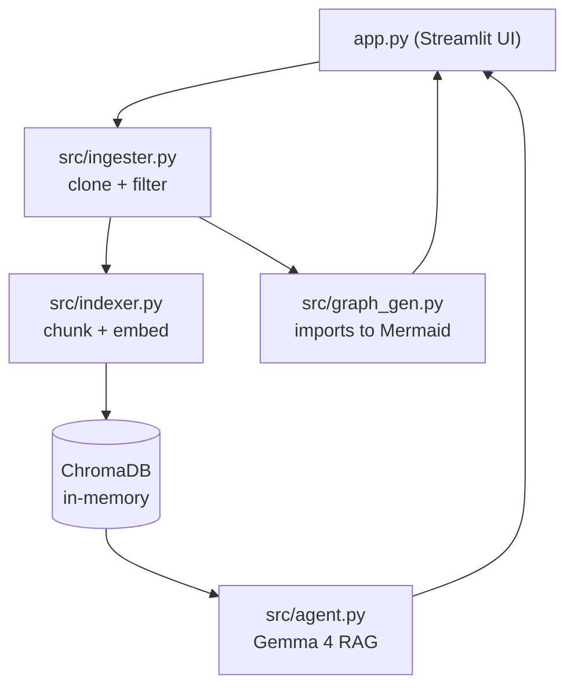

# 🧠 RepoMind AI

**Open-Source Codebase Intelligence & Architecture Visualizer**

Paste any public GitHub URL and get (1) an interactive architecture map built from real import statements and (2) a chat interface that answers questions about the code using RAG over Gemma 4 via the Gemini API.

  

## ✨ Features

- **One-click analysis**: shallow-clones a public repo, skipping `node_modules`, `.git`, `__pycache__`, `dist`, lockfiles, binaries and minified bundles.
- **Architecture map**: Mermaid `graph TD` generated from `import` / `from` / `require` statements (Python via `ast`; JS/TS and Java/Kotlin via regex). Folders become subgraphs, 🟢 marks entry points and 🔴 marks most-imported hubs. Pan and zoom included.
- **RAG chat with streaming**: language-aware chunking, in-memory ChromaDB, MMR retrieval and Gemma 4 answers (served through the Gemini API) that cite the files they used.
- **Demo-fast**: shallow clone, capped chunk count, batched embeddings with retry/backoff.
- **Fails gracefully**: missing API key, invalid URL, private repo, rate limits and unparseable files all produce friendly messages.

## 🏗️ Architecture



## 🚀 Setup

```bash
git clone https://github.com/<you>/repomind-ai.git
cd repomind-ai
python -m venv .venv && source .venv/bin/activate   # Windows: .venv\Scripts\activate
pip install -r requirements.txt
cp .env.example .env        # optional: put GOOGLE_API_KEY in it
streamlit run app.py
```

Requirements: Python 3.10+, `git` on your PATH, and a free [Gemini API key](https://aistudio.google.com/apikey).

### Configuration (optional environment variables)

| Variable | Default | Purpose |
|---|---|---|
| `GOOGLE_API_KEY` | none | Pre-fills the sidebar key field |
| `GEMINI_MODEL` | `gemma-4-26b-a4b-it` | Chat model: Gemma 4 via the Gemini API. Use `gemma-4-31b-it` for higher quality |
| `GEMINI_EMBEDDING_MODEL` | `models/gemini-embedding-001` | Embedding model |
| `REPOMIND_MAX_FILES` | `500` | Max files extracted |
| `REPOMIND_MAX_CHUNKS` | `400` | Max chunks embedded (lower = faster demo) |

## 🎬 3-Minute Demo Script

1. Paste your API key and a small/medium repo URL, click **Analyze Repository**.
2. Open **Architecture Map**: point out entry points (green) and hubs (red).
3. Switch to **Chat** and ask "Explain the overall architecture", then a follow-up like "Where is the entry point?".

## 📁 Project Structure

```
repomind-ai/
├── app.py              # Streamlit dashboard
├── src/
│   ├── ingester.py     # clone + file extraction
│   ├── indexer.py      # chunking + ChromaDB embeddings
│   ├── graph_gen.py    # import parsing + Mermaid generation
│   └── agent.py        # Gemini RAG agent
├── requirements.txt
├── .env.example
└── LICENSE
```

## 🤝 Contributing (Hacktoberfest)

Contributions are welcome. Good first issues:

- Add import parsers for Go, Rust, C/C++ (`#include`) or PHP in `src/graph_gen.py`
- Support private repos via a GitHub token
- Persist indexes between sessions
- Add tests for `graph_gen.py` and `ingester.py`

Fork, create a branch, make your change, and open a pull request.

## 📄 License

Released under the [MIT License](LICENSE).
